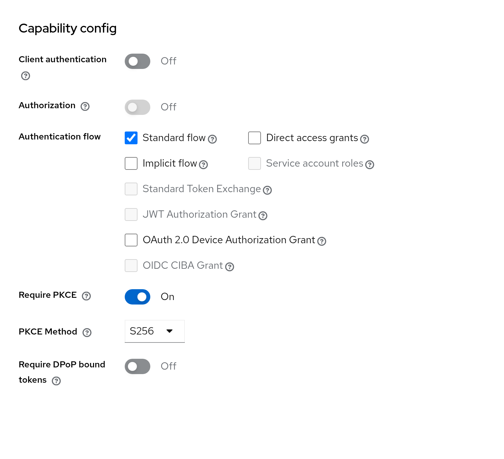
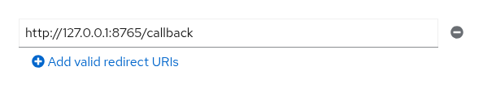
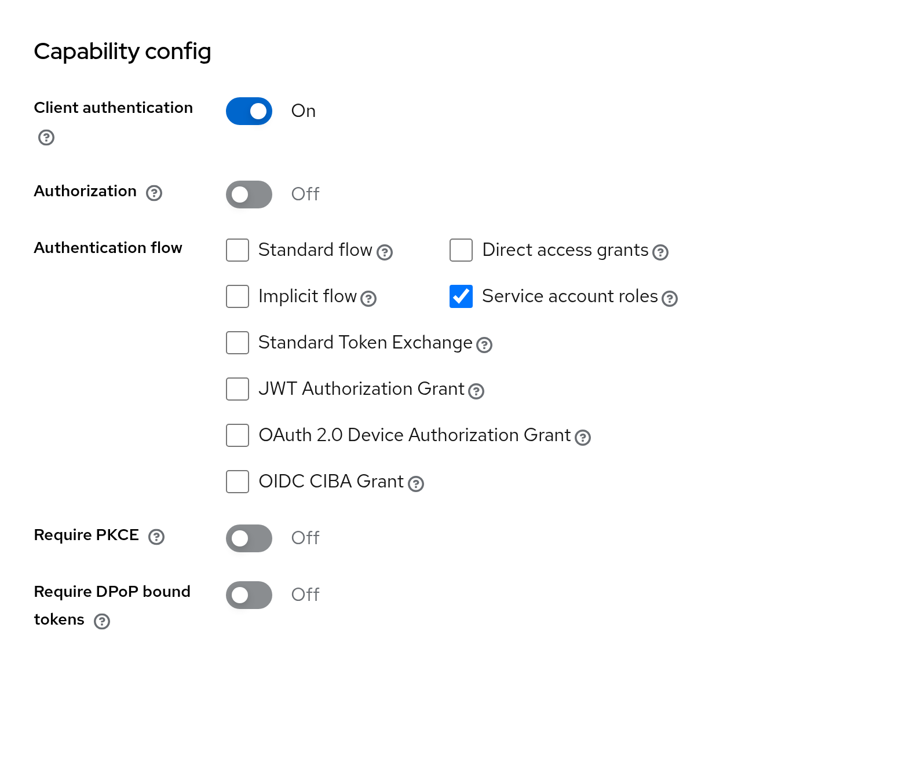
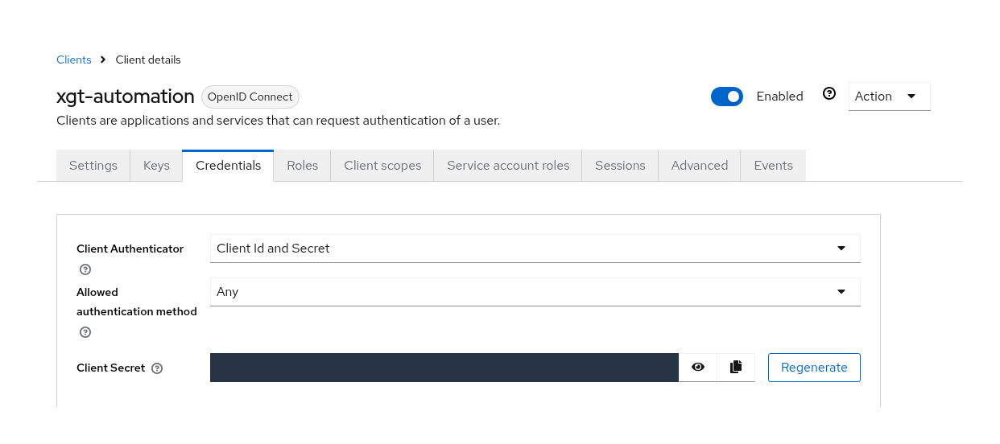
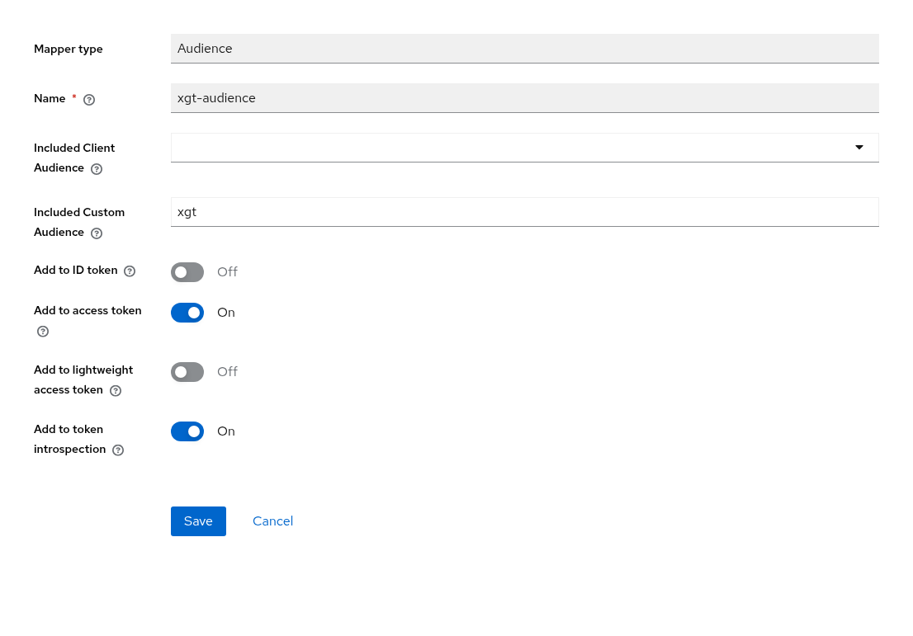
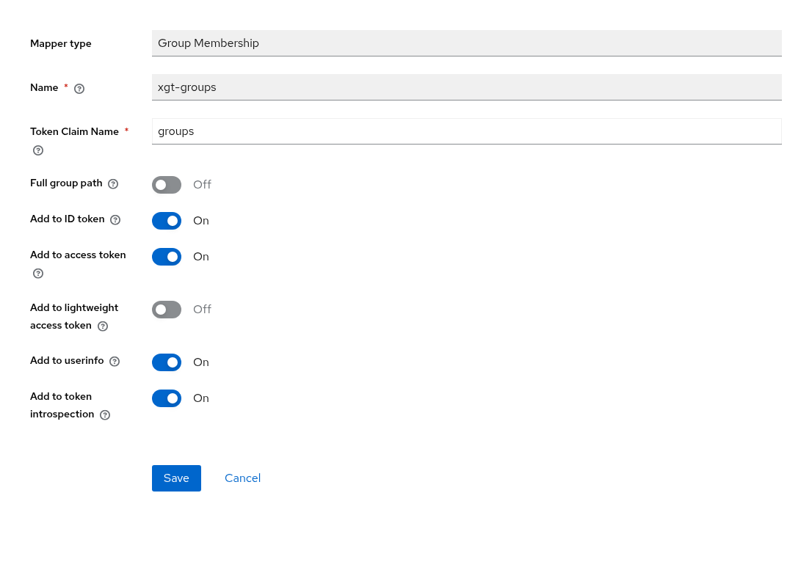
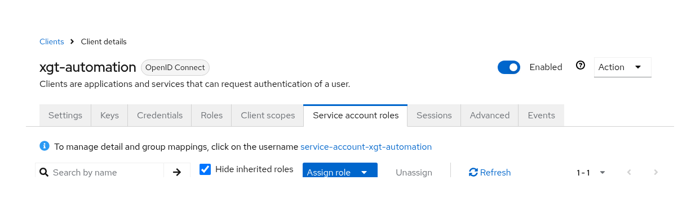
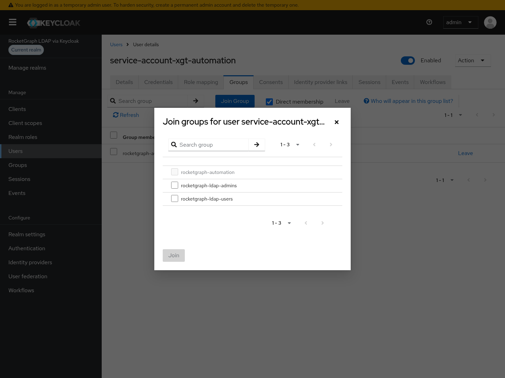

# Keycloak Setup for xGT

Use Keycloak to sign in as a normal user or an automation service account. Keycloak issues a token; xGT validates it and maps its groups to security labels. LDAP federation and Mission Control are optional.

Experimental: OIDC authentication may change in future releases.

Start with xGT 2.7.1 and an existing Keycloak realm. Python must reach xGT; Python, xGT and the login browser must reach the Keycloak HTTPS endpoint. Replace the example hostnames and realm with your own. Screenshots show a test realm; settings can appear in different places in other Keycloak versions. The Helm examples use Rocketgraph chart **0.5.0**.

The minimum setup is:

1.  Create the Keycloak client for the login method you need.
1.  Add audience `xgt` to its access tokens. For group-based permissions, include `groups` and assign the user or service account to a group.
1.  Configure xGT with the issuer, audience and JWT validation, then map groups to xGT labels.
1.  If a component does not trust Keycloak HTTPS, configure its CA trust.
1.  Run the matching Python login example below and verify its labels.

The Keycloak steps and Python examples also apply outside OpenShift. The Helm, `oc` and Route examples are for deployments on OpenShift. When Keycloak issues the tokens, no OpenShift `OAuthClient` or LDAP-to-OpenShift group sync is needed. For tokens issued by OpenShift itself, see [OpenShift and LDAP quickstart](../openshift_ldap_quickstart.md) instead.

## Guide Files

Read this page first. Optional steps: [LDAP federation](ldap.md), [HTTPS trust](https_trust.md), and [Mission Control](mission_control.md). The [examples](examples/) are included inline and as downloadable files. Screenshots can be clicked to view their full size.

For the Helm commands, use a checkout or archive containing Rocketgraph chart **0.5.0** and run from its `doc/keycloak_setup` directory. The chart path is `../../charts/rocketgraph`; if your chart package is stored elsewhere, replace that path with your local 0.5.0 chart. Edit the placeholders in the relevant examples and supply the path to your existing deployment values file.

## 1. Create the Clients You Need

In your realm, open **Clients → Create client** and select **OpenID Connect**. Create only the clients needed for your deployment:

| Setting | Normal-user Python login | Automation scripts | Mission Control |
|----|----|----|----|
| Client ID | `xgt-browser` | `xgt-automation` | `mission-control` |
| Client authentication | Off | On | On |
| Standard flow | On | Off | On |
| Service account roles | Off | On | Off |
| Direct access grants / Implicit flow | Off | Off | Off |
| PKCE | Required, `S256` | Not used | Not required for Mission Control 2.7.0 |
| Valid redirect URIs | `http://127.0.0.1:8765/callback` | None | `https://mc.example.com/api/login/oidc/callback` |

Keep the default `profile` and `email` client scopes. Client IDs identify applications, not user accounts. Separate clients let Python browser login remain public while keeping the automation and Mission Control secrets independent. Sharing a confidential client is possible, but Python browser login then also needs its secret.

### Normal-User Login

The public `xgt-browser` client opens a browser for a person to sign in. Require PKCE with method `S256`; older Keycloak versions expose this under Advanced settings as **PKCE Code Challenge Method**.

<a href="images/browser-capabilities.png"></a>

Capability settings for normal-user Python login.

Register the callback exactly in **Valid redirect URIs**, without a trailing slash. Change it if you use a different `callback_port` in Python.

<a href="images/browser-callback.png"></a>

The default Python loopback callback.

### Automation

The confidential `xgt-automation` client obtains tokens without a browser. Enable **Client authentication** and **Service account roles**. Leave the other authentication flows off.

<a href="images/automation-capabilities.png"></a>

Capability settings for automated jobs.

Open **Credentials** and copy this client's generated **Client Secret**. The Python job uses it to obtain a token. It is not the Keycloak administrator password, and xGT does not need it for JWT validation.

<a href="images/automation-credentials.png"></a>

Where to obtain the automation client's secret.

## 2. Add Audience and Group Token Mappers

Do this on **each client that issues tokens for xGT**, including Mission Control if used. Open **Client scopes → CLIENT_ID-dedicated → Mappers → Add mapper → By configuration**, create the following mappers, and save each one.

### Audience Mapper

| Field | Value |
|----|----|
| Mapper type / Name | `Audience` / `xgt-audience` |
| Included Client Audience | Leave empty |
| Included Custom Audience | `xgt` |
| Add to access token | On |
| Add to ID token / Add to lightweight access token | Off |
| Add to token introspection | Needed only for introspection validation |

`xgt` is the expected audience, not another client that must be registered. It must match `security.oidc.audience` on the server.

<a href="images/audience-mapper.png"></a>

The screenshot also enables introspection; JWT validation uses the access token.

### Group Membership Mapper

| Field | Value |
|----|----|
| Mapper type / Name | `Group Membership` / `xgt-groups` |
| Token Claim Name | `groups` |
| Full group path | Off for the flat group names in this example |
| Add to access token | On |
| Add to lightweight access token | Off |
| Add to ID token / Add to userinfo | Not required for JWT validation |
| Add to token introspection | Needed only for introspection validation |

<a href="images/groups-mapper.png"></a>

The screenshot enables additional outputs; JWT validation needs the groups in the access token.

This mapper copies existing memberships into tokens; it does not assign memberships. LDAP federation uses a separate LDAP group mapper, described in [LDAP federation](ldap.md).

## 3. Assign Group Memberships

Reuse existing Keycloak groups, including groups already synchronized from LDAP. Creating a new group is optional. The examples below use `rocketgraph-ldap-admins`, `rocketgraph-ldap-users` and the optional `rocketgraph-automation` group; replace them with your actual names.

For a normal user, use **Users → USER → Groups**, or manage memberships in LDAP when the directory owns them. For an automation account:

1.  Open **Clients → xgt-automation → Service account roles**.
1.  Click the linked username **service-account-xgt-automation**.
1.  Open **Groups → Join Group**, select the existing group, and click **Join**.

<a href="images/service-account-link.png"></a>

Open the service-account user through its client.

<a href="images/service-account-join-groups.png"></a>

Choose the group whose xGT labels the automation job needs.

Service-account users are normally excluded from the default Users list. Membership is stored in Keycloak; joining a synchronized group does not create an LDAP user or write a membership back to LDAP. The account does not inherit LDAP users' groups automatically. Reconnect with a fresh token and session when memberships change.

## 4. Configure xGT

Merge this block into `xgtd.conf`, retaining the deployment's license, storage, resource and TLS settings:

``` json
{
  "security.oidc": {
    "issuer": "https://keycloak.example.com/realms/rocketgraph",
    "client_id": "xgt-browser",
    "audience": "xgt",
    "validation_mode": "jwt",
    "username_claim": "preferred_username",
    "groups_claim": "groups",
    "scopes": "openid profile email"
  }
}
```

For automation only, omit `client_id`; the job supplies `xgt-automation` explicitly. The configured `client_id` advertises the default browser client, while `audience` controls which tokens xGT accepts. xGT fetches discovery information and public signing keys from Keycloak; JWT validation needs no client secret on xGT. See [xGT Keycloak reference](https://docs.rocketgraph.com/sysadmin_guide/user_authentication.html#keycloak) for validation modes, including introspection, which uses server-side credentials.

In `grouplabel.csv`, map the selected Keycloak groups to xGT labels:

``` text
group,label
xgtd,xgtadmin
rocketgraph-ldap-admins,xgtadmin
rocketgraph-ldap-users,data-users
rocketgraph-automation,automation
```

Declare the labels in `label.csv`:

``` text
label
xgtadmin
data-users
automation
```

Keep existing mappings your deployment needs. A service account joining `rocketgraph-ldap-users` receives `data-users`; no new automation group or label is required. Grant labels access to the frames the job needs using [configuring groups and labels](https://docs.rocketgraph.com/sysadmin_guide/configuration.html#configuring-groups-and-labels). A label alone does not grant access to all data; `xgtadmin` is the administrator label.

### Using Helm on OpenShift

Download [keycloak_values.yaml](examples/keycloak_values.yaml) and merge it into your existing values. It generates the OIDC settings and CSV files described above:

``` yaml
# Merge into the deployment's existing values; keep its license, hostname,
# images, storage and TLS settings. Update existing mounted config files instead
# if xgt.config.existingConfigMap or a files PVC supplies the configuration.
xgt:
  config:
    # Reuse your existing groups and labels; these names are examples.
    # The rocketgraph-automation group and automation label are optional.
    grouplabelCsv: |
      group,label
      xgtd,xgtadmin
      rocketgraph-ldap-admins,xgtadmin
      rocketgraph-ldap-users,data-users
      rocketgraph-automation,automation
    labelCsv: |
      label
      xgtadmin
      data-users
      automation
  extraConfig:
    security.oidc:
      issuer: https://keycloak.example.com/realms/rocketgraph
      # Default client for normal-user browser login; this is not a username.
      # Omit client_id for automation only; Python supplies xgt-automation.
      client_id: xgt-browser
      audience: xgt
      validation_mode: jwt
      username_claim: preferred_username
      groups_claim: groups
      scopes: openid profile email
      # If xGT lacks CA trust, see the HTTPS trust page: use keycloak_ca_values.yaml
      # or the OpenShift injected ConfigMap alternative openshift_ca_values.yaml.
```

Commands assume version **0.5.0** of the [Rocketgraph chart](https://github.com/Rocketgraphai/rocketgraph/tree/main/charts/rocketgraph) is available locally at `../../charts/rocketgraph`. Use your actual chart path, release and namespace, and include all existing deployment values files:

``` bash
helm upgrade YOUR_RELEASE ../../charts/rocketgraph -n YOUR_NAMESPACE \
  -f YOUR_EXISTING_VALUES.yaml -f examples/keycloak_values.yaml
```

If an existing ConfigMap or files PVC supplies `xgtd.conf`, update its OIDC configuration and CSV files directly instead of using this overlay. The chart rejects `xgt.extraConfig` and inline CSV settings alongside external configuration. For a hostname-bound license, retain `xgt.hostname` with a hostname covered by the license; no custom StatefulSet is needed.

For OpenShift's non-root profile, retain `openshift.enabled: true` and `openshift.scc: restricted-v2`. Select FIPS images with `fips.enabled: true` and keep image tags without a `-fips` suffix; the chart appends it. Mission Control currently requires FIPS images for this profile. Configure each connection's TLS separately. Image selection alone does not establish FIPS compliance, and existing PVC contents must be writable by the admitted UID and volume group. See the chart's restricted-v2 and FIPS sections for deployment requirements; these authentication settings do not replace them.

## 5. Configure HTTPS Trust If Needed

Skip extra CA settings only where the application's trust store already trusts Keycloak. A private company CA trusted by an OpenShift node or a browser is not automatically trusted inside the stock containers.

Follow [HTTPS trust](https_trust.md) to mount an approved CA bundle into xGT and Mission Control and set the matching Python CA path. That page also shows the optional direct mount of an OpenShift-injected trusted bundle. The browser needs its own trust configuration.

OIDC does not enable TLS for the Python-to-xGT connection. If xGT requires TLS, add the connection flags and certificate trust from [Python connection TLS settings](https://docs.rocketgraph.com/user_ref/usingxgt/connecting_to_server.html#connect-via-ssl-encrypted-network-connection). In SDK 2.7.1, an omitted `ca_cert_path` defaults to `ssl_server_cert` when xGT TLS is enabled. If that file does not trust Keycloak, explicitly set `ca_cert_path` to a bundle that does, even for publicly issued Keycloak certificates. See [HTTPS trust](https_trust.md).

## 6. Test Automation and Normal-User Login

Install the matching Python client:

``` bash
python3 -m pip install xgt==2.7.1
```

### Automation / Service-Account Login

Download [connect_automation.py](examples/connect_automation.py) or save the complete example below. Replace the host and supply `XGT_AUTOMATION_CLIENT_SECRET` through the environment. For scheduled jobs, populate it from the job's secret store. Uncomment `ca_cert_path` if Python needs a Keycloak CA bundle, including when xGT TLS supplies a different CA.

``` python
"""Log in to xGT as a Keycloak automation service account."""
import os

import xgt

conn = xgt.Connection(
  host = "xgt.example.com",
  port = 4367,
  # For xGT TLS, add the connection flags described in the SSL guide.
  auth = xgt.OidcCredentialsAuth(
    client_id = "xgt-automation",
    # Set if Python needs a Keycloak CA bundle, including when xGT TLS
    # supplies a different ssl_server_cert.
    # ca_cert_path = "~/.config/rocketgraph/keycloak-ca.pem",
    client_secret = os.environ["XGT_AUTOMATION_CLIENT_SECRET"]))

print("User:", conn.userid)
print("Labels:", conn.get_user_labels())
print("Test query:", conn.run_job("RETURN 1 AS ok").get_data())
```

``` bash
printf "Keycloak automation client secret: "
read -r -s XGT_AUTOMATION_CLIENT_SECRET
printf '\n'
export XGT_AUTOMATION_CLIENT_SECRET
python3 examples/connect_automation.py
unset XGT_AUTOMATION_CLIENT_SECRET
```

Expect `service-account-xgt-automation`, the chosen group's mapped labels, and query result `[[1]]`. No browser or LDAP password is involved.

### Normal-User Browser Login

Download [connect_user.py](examples/connect_user.py) or save this example. It uses the public `xgt-browser` client advertised by xGT; a client secret is unnecessary. The same `ca_cert_path` guidance applies when adding xGT TLS flags.

``` python
"""Open a browser to log in to xGT with a normal Keycloak or LDAP account."""
import xgt

conn = xgt.Connection(
  host = "xgt.example.com",
  port = 4367,
  # For xGT TLS, add the connection flags described in the SSL guide.
  auth = xgt.OidcAuth(
    flow = "auth_code",
    # Set if Python needs a Keycloak CA bundle, including when xGT TLS
    # supplies a different ssl_server_cert.
    # ca_cert_path = "~/.config/rocketgraph/keycloak-ca.pem",
    force_login = True))

print("User:", conn.userid)
print("Labels:", conn.get_user_labels())
print("Test query:", conn.run_job("RETURN 1 AS ok").get_data())
```

``` bash
python3 examples/connect_user.py
```

Sign in with your normal Keycloak or federated LDAP account. Keep Python running, and make sure the browser can reach its loopback callback. If the browser runs on another machine, forward port 8765 to the Python machine. Verify the returned identity, labels and query result. Keycloak's issuer hostname must resolve and its HTTPS certificate must be trusted by the browser as well as Python.

## Troubleshooting

| Symptom | Check |
|----|----|
| Automation login rejected | Client ID/secret, Client authentication On and Service account roles On. |
| Audience rejected by xGT | Access token contains `xgt` and xGT expects that audience. |
| Login succeeds but labels are missing | Group Membership mapper, memberships and matching CSV names. |
| Labels present but data operation denied | Frame permissions grant access to the required label. |
| Invalid browser redirect URI | Exact callback URI, including scheme, port and `/callback`. |
| HTTPS certificate verification failed | CA trust for the failing component: Python, xGT, backend or browser. |
| Issuer hostname cannot be resolved | DNS on the failing machine; a CA file cannot fix DNS. |

## Optional Setup

- [LDAP Federation with Keycloak](ldap.md)
- [HTTPS Trust for Keycloak](https_trust.md)
- [Mission Control with Keycloak](mission_control.md)
