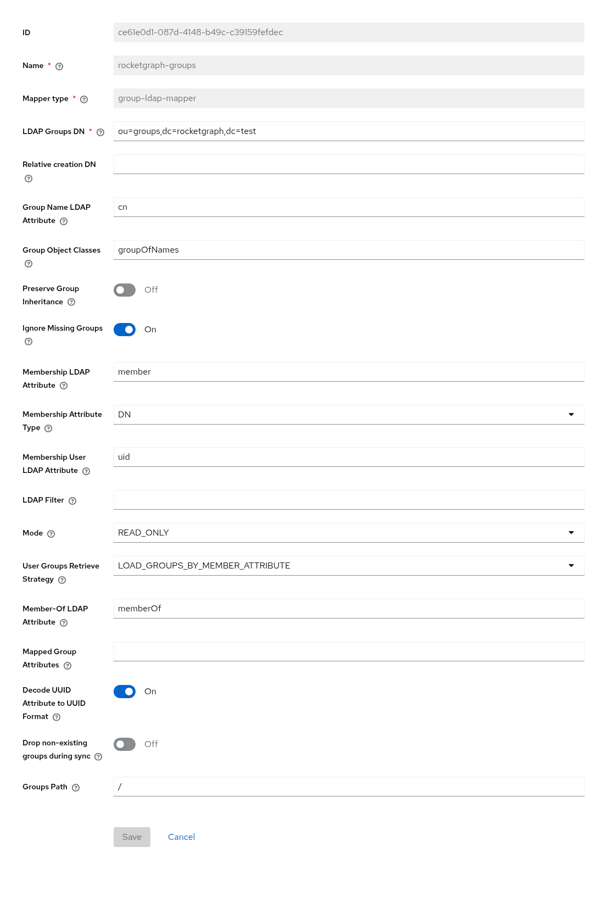

[Keycloak Setup](README.md)

# LDAP Federation with Keycloak

Use this when human users and groups already exist in LDAP. Keycloak validates their passwords and includes their groups in access tokens. xGT does not bind to LDAP. The Keycloak automation service account does not need LDAP federation.

## Add the LDAP Provider

In your realm, open **User federation → Add LDAP provider**. Obtain the LDAP settings and bind credentials from the directory administrator. For an OpenLDAP directory using `uid` and `groupOfNames`:

| Setting | Example |
|----|----|
| Connection URL | `ldaps://ldap.example.com:636` |
| Bind DN / Bind credentials | Directory administrator's read-only application account and password |
| Users DN | `ou=people,dc=example,dc=com` |
| Username and RDN LDAP attributes | `uid` |
| UUID LDAP attribute | `entryUUID` |
| User object classes | `inetOrgPerson` |
| Edit mode / Import users | `READ_ONLY` / On |

Adapt these attributes to the actual directory; Active Directory uses different schema settings. Keycloak must reach LDAP and trust its LDAPS certificate. Test the connection and authentication, then save.

## Add the LDAP Group Mapper

Open the provider's **Mappers → Add mapper** and select `group-ldap-mapper`. This imports groups into Keycloak; it is separate from the Group Membership token mapper on each OIDC client.

| Setting | Example |
|----|----|
| LDAP Groups DN | `ou=groups,dc=example,dc=com` |
| Group Name LDAP Attribute / Group Object Classes | `cn` / `groupOfNames` |
| Membership LDAP Attribute / Membership Attribute Type | `member` / `DN` |
| Membership User LDAP Attribute | `uid` |
| Mode | `READ_ONLY` |
| User Groups Retrieve Strategy | `LOAD_GROUPS_BY_MEMBER_ATTRIBUTE` |
| Preserve Group Inheritance | Off for flat group names |

The screenshot uses a test directory DN; substitute your own directory's DN.

Run **Sync LDAP Groups to Keycloak** on the mapper and **Synchronize all users** on the provider. Confirm the resulting user memberships, and use their exact group names in xGT's `grouplabel.csv`.

User synchronization and the group mapper's group synchronization are separate operations. Configure recurring synchronization appropriate for the directory, and verify it covers both. Reconnect with a fresh token and xGT session after memberships change.

An automation service account can join an existing synchronized group through its client's **Service account roles → username → Groups → Join Group**. That membership is stored in Keycloak, not written back to LDAP. Group creation is optional; return to [Keycloak setup](README.md) for token mappers and xGT label mappings. See [Keycloak LDAP federation](https://www.keycloak.org/docs/latest/server_admin/index.html#_ldap) for directory-specific options.
